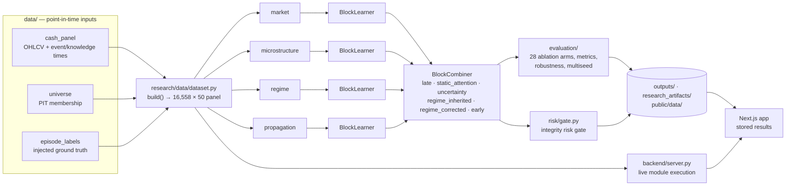

<div align="center"></div>

[← Engineering Portfolio](https://github.com/1stsimplifycode) · [Explore All Public Domains](https://github.com/1stsimplifycode/1stsimplifycode/blob/main/docs/PROJECT_DIRECTORY.md)

# AEGIS-MARKET-STATISTICS

**Market-integrity risk statistics platform — research, non-advisory.**

Capstone Phase-3 · Team `PW26_SSS_08`

This repository is the **statistics-only carve-out** of the AEGIS market-integrity project:
sixteen STATS modules that characterise the data, validate the risk model against it, and
report how much of any difference between configurations is real.

It ships three things:

| Layer | What it is |
|---|---|
| `research/` | A Python research pipeline — the canonical implementation of every statistic. |
| `backend/` | A small HTTP service that executes any module live on a slice you choose. |
| `app/`, `components/`, `lib/` | A Next.js 15 interface that reads both stored results and live runs. |

> **This project makes no investment recommendation.** Every surface carries a non-advisory
> notice, and `research/scenario/money.py` defines the only form in which a currency value
> may be stated.

---

## ⚠️ Read this before trusting a stored number

Every result under `outputs/`, `research_artifacts/` and `public/data/` was measured on the
**earlier 119-column panel** and then filtered down to the rows that survive on the current
**50-column** one. The surviving values are the ones the original run produced — they were
**not recomputed**.

Re-run the pipeline (`scripts/run_experiments.py`, then the STATS modules) before quoting any
stored number as a property of the current four-block configuration. **Live runs through the
backend are computed on the current panel and are unaffected.**

Two further provenance caveats are recorded in [`helper.md`](helper.md):

- `research/models/combiner.py` is a **reimplementation**, rebuilt from its call sites and
  from the invariants the leakage suite asserts. It passes every test including both L5
  properties, but its weighting arithmetic was *derived, not copied* from the parent AEGIS
  repository.
- Figures were individually triaged — some regenerated, some redrawn, some recomputed live
  (and so differ from the stored tables), and eleven deleted along with every citation to
  them, because their subject was a block this project no longer carries.

---

## The vocabulary

The panel carries four **evidence blocks** — `market`, `microstructure`, `regime`,
`propagation`. One learner per block, and a combination layer that weighs their calibrated
scores. That vocabulary is the same in the Python, the backend contract and the UI.



A **bitemporal evidence contract** (`research/core/contracts.py`) enforces that a query as of
an earlier cutoff can never see later knowledge; a violation raises `LeakageError`. An absent
block is **excluded, never imputed** — zero coverage means zero weight, and no evidence never
yields score 0.5 / uncertainty 1.0.

---

## Repository layout

```
research/            canonical implementations — nothing numeric lives anywhere else
  core/              bitemporal contract, strict JSON, licence gates, manifests, paths
  data/              panel assembly, point-in-time records, universe + survivorship guard
  market/            features, returns, liquidity, arrival intensity, thresholds
  models/            AegisRiskModel, BlockCombiner, baselines
  evaluation/        ablations, experiment runner, metrics, information, robustness,
                     temporal analysis, multiseed
  detection/         synthetic episode generator, state machine, count events
  regime/  propagation/  risk/  scenario/  statistics/  xai/  limitations/
scripts/             run_module.py dispatcher, experiment runners, STATS adapters
backend/             server.py, service.py, registry.py, contract.py
STATS/               16 generated module directories (README.md + run.bat each)
tools/               aegis_module.bat — the shared runner every run.bat delegates to
app/                 Next.js routes: product surfaces, /stats, /research lab, API proxy
components/          modules/ run/ product/ research/ visualization/ ui/
lib/                 domain types, module readers, data-bundle readers, mode context
tests/               leakage suite (L1–L6) + week-2 threshold tests
data/                panel/ and reference/ inputs (parquet + csv)
outputs/  research_artifacts/  public/data/  public/figures/   generated artifacts
```

**`research_modules.yaml` is the single source of truth.** `STATS/`, every `run.bat` and every
module `README.md` are generated from it — it declares each module's canonical implementation,
adapter, inputs, outputs, UI schema and status. **Edit the manifest, not the generated files.**

`.next/`, `.venv/`, `node_modules/`, `.pytest_cache/` and `__pycache__/` are regenerated. None
of them are source.

---

## The sixteen STATS modules

| # | Module | Question it answers |
|---|---|---|
| 01 | data integrity profile | What does the assembled panel contain, and where is coverage thin? |
| 02 | universe survivorship | Is the instrument universe point-in-time, and how did membership turn over? |
| 03 | descriptive distributions | How do the features behave, and which are constant on this slice? |
| 04 | market microstructure | What do the liquidity proxies show, and what is not measurable at all? |
| 05 | regime statistics | How do sessions distribute across regimes? |
| 06 | dependence propagation | How does movement propagate across instruments? |
| 07 | tail extreme risk | How heavy are the tails, how deep the drawdowns? |
| 08 | episode event statistics | How are the injected episodes distributed? |
| 09 | leakage verification | Can information from after a decision time reach a feature? |
| 10 | validation verification | What do the metrics say at a threshold you choose? |
| 11 | calibration uncertainty | Are the scores calibrated at your chosen binning? |
| 12 | error analysis | Where does the scoring fail, and what kind of failure is each? |
| 13 | baseline comparison | Is this better than something simpler? |
| 14 | ablation study | Which components carry the result? |
| 15 | robustness generalization | What survives perturbation? |
| 16 | multiseed significance | How much of a difference is seed noise? |

14 of 16 have stored output under `outputs/stats/NN_*/`.

---

## Requirements

- **Python ≥ 3.12** (`pyproject.toml`)
- **Node ≥ 20** (`package.json`)
- The `.bat` runners (`run_dev.bat`, `run-demo-stats.bat`, `STATS/*/run.bat`,
  `tools/aegis_module.bat`) are **Windows-only**; on Linux/macOS call
  `scripts/run_module.py` directly.

Python dependencies are pinned in `requirements.txt` — numpy, pandas, scipy, scikit-learn,
matplotlib, statsmodels, networkx, pyarrow, duckdb, shap, Pillow, soundfile, imageio,
imageio-ffmpeg, PyYAML, requests, pytest.

---

## Getting started

### Python side

```bash
python -m venv .venv
.venv\Scripts\activate                # Windows
# source .venv/bin/activate           # Linux / macOS
pip install -r requirements.txt

python -m pytest tests/ -q            # 25 tests
python scripts/run_module.py --list   # every module and its status
python scripts/run_module.py --module STATS-01
python -m backend.server              # the execution service
```

On Windows the documented invocation uses the venv interpreter directly, e.g.
`.venv\Scripts\python.exe -m pytest tests/ -q`.

### Frontend

```bash
npm install
npm run dev            # Next.js dev server
npm run build          # typecheck + static build
npm run lint
npm run typecheck
```

`run_dev.bat` starts the Python backend and the Next.js dev server together.
`run-demo-stats.bat` checks the panel exists, then walks the STATS modules in order.
`STATS/run_all_stats.bat` runs all sixteen.

`app/api/aegis/[...path]/route.ts` proxies to the Python backend with a stored-artifact
fallback — the response **always says which of the two it served**.

---

## Data

| Path | What it is |
|---|---|
| `data/panel/market_dataset.{parquet,csv}` | **The modelling panel** — 16,558 rows × 50 columns: keys, decision and knowledge times, the four feature blocks, coverage flags, episode labels, split column. |
| `data/panel/cash_panel.{parquet,csv}` | NSE daily cash panel: OHLC, volume, turnover, trades, with event and knowledge times. |
| `data/panel/episode_labels.{parquet,csv}` | Injected episode ground truth: state, phase, intensity, entry, exit. |
| `data/panel/universe.{parquet,csv}` | Point-in-time universe membership and rebalance history. |
| `data/reference/` | Liquidity state vector, realised variance, and the frozen week-2 threshold / overdispersion references the tests check against. |

---

## Testing and integrity guarantees

`tests/leakage/test_leakage_suite.py` covers **L1–L6**: as-of retrieval, future shift,
restatement, survivorship, coverage substitution (an absent block is excluded, never imputed),
and threshold provenance.

> **A failure in the leakage suite invalidates every dependent claim.**

`tests/week2/` covers threshold derivation. Run everything with `python -m pytest tests/ -q`
— currently **25 passing**.

Other standing guarantees, each enforced in code rather than by convention:

- One return convention, enforced by a test rather than a comment (`research/market/returns.py`).
- Anomaly thresholds set from a **false-alarm budget declared before the data is seen**.
- Generator/detector separation keeps synthetic episode parameters invisible to any model.
- Licence gates default an unverifiable source to `UNKNOWN` and exclude it from redistributable
  artifacts.
- Every published artifact is written through strict deterministic JSON — fixed key order, no NaN.
- `research/limitations/registry.py` holds **15 limitations and 7 negative findings**, each with
  its invalidated claims, forbidden phrasings and follow-up research questions.

---

## The research lab

`/research` in the interface exposes the evidence behind every number: the claim ledger, the
artifact inventory, source provenance and licensing, the ablation arms by AUPRC with block
information decomposition, calibration/significance/uncertainty, every operating threshold and
how it was derived, the XAI methods with their validity scopes, the limitations register, and a
reproducibility page stating what reproduces bit-identically and what does not.

---

## Licence

No licence file is present in this repository. Absent one, default copyright applies and no
reuse rights are granted — add a `LICENSE` file if that is not the intent.

---

## Further reading

[`helper.md`](helper.md) documents **every file in the repository**, one line each, plus the
full figure-provenance triage and the combiner provenance note.
